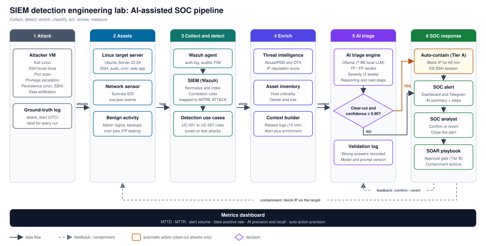
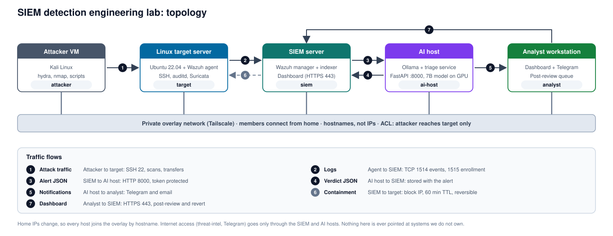
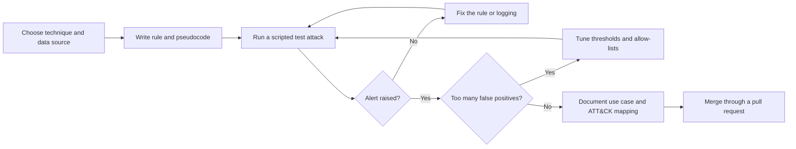
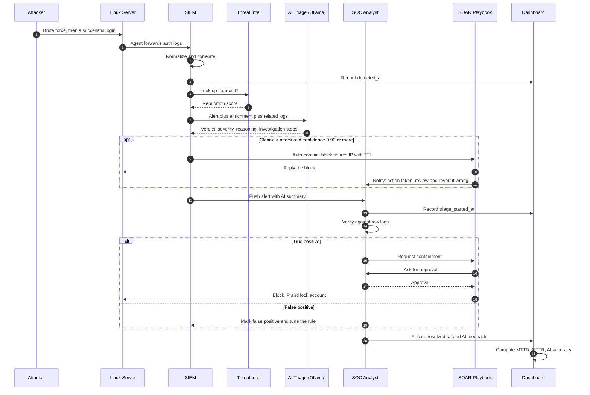
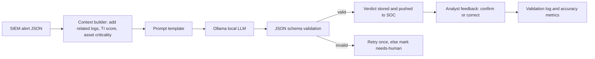
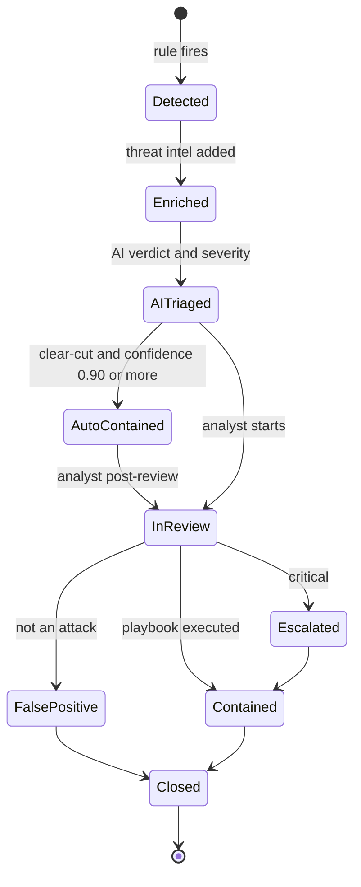
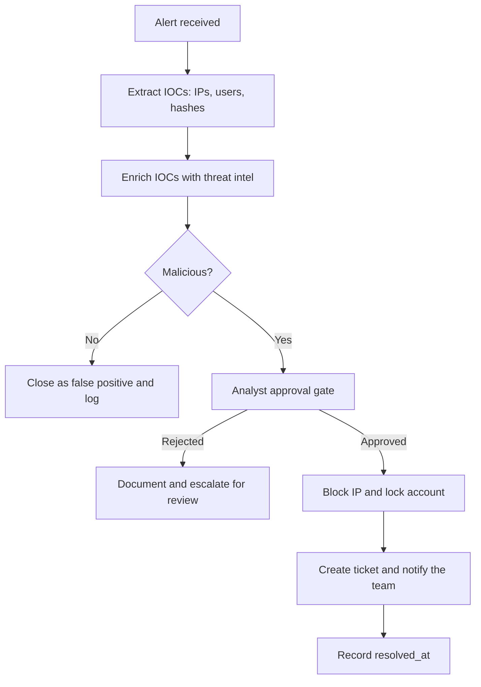
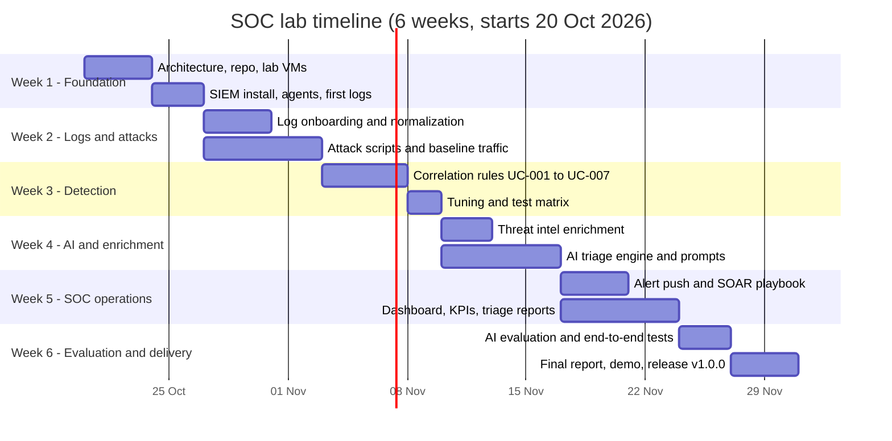
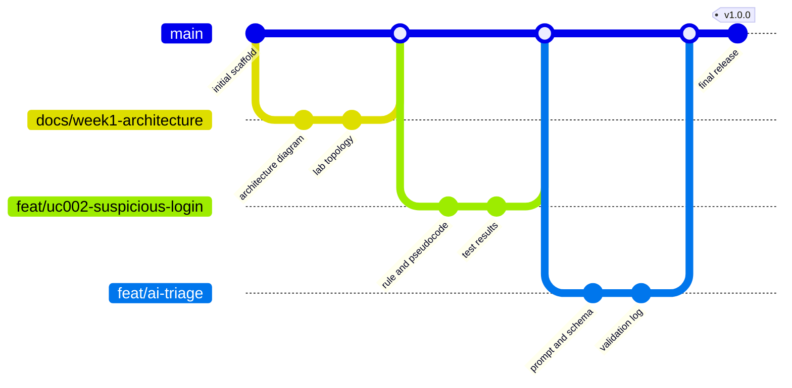

<div align="center">

# SIEM detection engineering, alert triage and SOC operations lab

### With a local AI analyst (Ollama), built by a remote team on free tools

**Collect. Detect. Classify. Alert. Investigate. Respond. Measure.**


-8957e5)


</div>

> Graduation project for the **Cyber Security Incident Response Analyst** track.
> Educational lab project: every attack runs in an isolated environment we own.

---

## Table of Contents

- [What is this project?](#what-is-this-project)
- [The Problem and the Solution](#the-problem-and-the-solution)
- [How it works in 30 seconds](#how-it-works-in-30-seconds)
- [Architecture](#architecture)
- [Lab topology](#lab-topology)
- [Remote team setup](#remote-team-setup)
- [Local AI models](#local-ai-models)
- [Working solo or on two machines](#working-solo-or-on-two-machines)
- [Repository hygiene and secrets](#repository-hygiene-and-secrets)
- [Attack scenarios and use cases](#attack-scenarios-and-use-cases)
- [End-to-end flow](#end-to-end-flow)
- [AI triage engine](#ai-triage-engine)
- [Alerting to the SOC](#alerting-to-the-soc)
- [Alert lifecycle and KPIs](#alert-lifecycle-and-kpis)
- [Threat intelligence and SOAR](#threat-intelligence-and-soar)
- [Six-week plan](#six-week-plan)
- [Team, roles and handoffs](#team-roles-and-handoffs)
- [Git workflow](#git-workflow)
- [Repository structure](#repository-structure)
- [Tech stack and requirements](#tech-stack-and-requirements)
- [Quick start](#quick-start)
- [Evaluation: how we prove it works](#evaluation-how-we-prove-it-works)
- [Risks and mitigations](#risks-and-mitigations)
- [Results](#results)
- [Deliverables tracker](#deliverables-tracker)
- [Disclaimer](#disclaimer)
- [License](#license)

---

## What is this project?

**This project is a small, complete SOC built around a SIEM and a local AI analyst.**

We attack a Linux server in an isolated lab. A SIEM collects and normalizes the logs and raises alerts with
correlation rules we write and test. A **local LLM (Ollama)** then reviews every alert, decides whether it is a
**True Positive or a False Positive**, assigns a severity (**Info, Low, Medium, High, Critical**), and sends the
SOC analyst a short explanation with the **investigation steps** to follow. For **clear-cut attacks** it also **acts immediately** by blocking the source IP. The analyst reviews every decision, handles the rest, and
the dashboard measures how well the whole SOC performed (MTTD, MTTR, precision and recall).

Reference scenario: a medium-sized organization (about 200 users, Linux servers and a web application),
implemented as a scaled-down lab.

## The Problem and the Solution

| Common problem                                  | What this project does about it                                         |
| ----------------------------------------------- | -------------------------------------------------------------------- |
| Logs are scattered across systems and formats   | Onboards and normalizes logs from servers, network and applications  |
| Detection rules are noisy or untested           | Writes rules and tunes them against real, scripted attacks           |
| Analysts drown in alerts                        | A local LLM classifies TP/FP and ranks severity before a human looks |
| Investigations are inconsistent                 | AI suggests a structured checklist; the analyst follows one workflow |
| Nobody knows what the SOC can actually detect   | Every rule is mapped to MITRE ATT&CK with a coverage map             |
| Response is manual and slow                     | SOAR playbook with approval gates                                    |
| SOC performance is guesswork                    | MTTD, MTTR, alert volume, and AI accuracy measured on a dashboard    |

## How it works in 30 seconds

1. The **attacker VM** attacks the **Linux target server** (for example SSH brute force, then a successful login).
2. **Wazuh agents** forward `auth.log`, `auditd` and network logs to the **SIEM**.
3. The SIEM **normalizes** the events and a **correlation rule** fires an alert.
4. The alert is **enriched** with threat intelligence (IP reputation, asset criticality).
5. The **AI triage engine (Ollama)** returns: verdict (TP/FP), severity, reasoning, and investigation steps.
6. If the attack is **clear-cut** (for example SSH brute force) and the AI is confident, it **acts immediately**: the SOAR blocks the source IP for a limited time. Everything else goes to the analyst.
7. The AI **pushes every alert and every action to the SOC** (dashboard plus chat or email notification).
8. The **analyst reviews every AI decision**, can **revert** any automatic action, handles the non-obvious alerts through the **SOAR playbook** after approval, and closes the alert.
9. The **dashboard** computes KPIs from recorded timestamps and scores the AI against ground truth.

---

## Architecture

<p align="center">
  <a href="docs/architecture.svg"></a>
  <br><sub><b>Figure 1.</b> End-to-end pipeline, from the scripted attack to the SOC response and the metrics dashboard. Click to open full size.</sub>
</p>

| Layer      | Component                                  | Purpose                                      |
| ---------- | ------------------------------------------ | -------------------------------------------- |
| Assets     | Linux server, web app, Suricata sensor     | What we monitor and attack                   |
| Collection | Wazuh agent, auditd, rsyslog               | Gets events to the SIEM                      |
| SIEM       | Wazuh (or ELK), single node                | Normalize, store, search, correlate          |
| Enrichment | AbuseIPDB, AlienVault OTX, asset inventory | Adds context to each alert                   |
| AI triage  | Ollama (local LLM) plus a Python service   | Classify TP/FP, rank severity, suggest steps |
| SOC        | Notifications, analyst workflow, SOAR      | Verify, investigate, contain                 |
| Metrics    | Dashboard and KPI calculator               | Prove performance with numbers               |

Production would use a clustered SIEM; the lab uses a single node and documents what was simplified.

## Lab topology

<p align="center">
  <a href="docs/lab-topology.svg"></a>
  <br><sub><b>Figure 2.</b> The five lab hosts on a private overlay network, reached by hostname, with the seven traffic flows. Click to open full size.</sub>
</p>

The team works from different homes and ISP IPs change, so **no config or script in this repo may contain an IP address**: every host is
reached by **hostname**. The lab runs in one of two modes:

| Host                | Hostname   | Mode A: one machine (VirtualBox host-only) | Mode B: distributed team (overlay VPN) |
| ------------------- | ---------- | ------------------------------------------ | -------------------------------------- |
| Attacker VM         | `attacker` | 192.168.56.10                              | stable overlay name `attacker`         |
| Linux target server | `target`   | 192.168.56.20                              | stable overlay name `target`           |
| SIEM server         | `siem`     | 192.168.56.30                              | stable overlay name `siem`             |
| AI host              | One machine with an NVIDIA GPU (RTX 3060 / 3050 class, 8 GB VRAM ideal) and 16 GB RAM; runs 7B to 8B models |
| Analyst workstation | `analyst`  | 192.168.56.50                              | stable overlay name `analyst`          |

Mode A is for quick solo testing; **Mode B is the default for the team** (see [Remote team setup](#remote-team-setup)).
Example IPs in this README come from Mode A. In Mode B the lab only reaches the internet through the SIEM and AI hosts
(package installs, threat-intel lookups, Telegram). Nothing in this repository is ever pointed at systems we do not own.

## Remote team setup

**Problem:** six people in different places, dynamic home IPs, and many home ISPs put you behind CGNAT, so port forwarding is not an option.
**Solution:** a free **overlay VPN (Tailscale, Personal plan)**. Every machine gets a stable name (`siem`, `target`, ...) that survives IP changes,
connects peer to peer through NAT, and falls back to a relay when a direct path is impossible. As of mid-2026 the free plan covers up to
6 users with unlimited personal devices; check the pricing page in week 1, and if the team grows past the limit use Headscale (self-hosted, free) or ZeroTier.

**Who hosts what** (not everyone runs everything):

| Machine                             | Runs                                         | Why                                            |
| ----------------------------------- | -------------------------------------------- | ---------------------------------------------- |
| Strongest GPU (RTX 3060, 16 GB RAM) | `ai-host`: Ollama + FastAPI triage service   | The only box that needs the 7B-8B model        |
| Best RAM (16 GB+)                   | `siem`: Wazuh all-in-one VM (4 vCPU, 8 GB)   | Wazuh is the heaviest component                |
| Any third machine                   | `attacker` and `target` VMs (2 GB each)      | Light; keeps the SIEM host free                |
| Everyone else                       | `analyst` (browser) and their own dev setup  | Dev on saved alert fixtures plus a 3B model    |

**Steps**

1. One person creates the tailnet and invites the others (Admin console, Users).
2. Install the client **inside each VM and on the AI host**, not only on the laptop:
   `curl -fsSL https://tailscale.com/install.sh | sh && sudo tailscale up --hostname=target`.
3. Tag the machines and apply the ACL below (`infra/overlay/acl.hujson`): default deny, only the flows in the topology are open.
4. Point everything at hostnames: Wazuh agents use `<address>siem</address>`, the SIEM calls `http://ai-host:8000`, the allow-list uses hostnames.
5. Keep Ollama on `127.0.0.1`; teammates only talk to the FastAPI service (port 8000, token protected).
6. Verify: every host answers `ping <hostname>`, an agent shows as *active* in Wazuh, and `curl http://ai-host:8000/health` works from `siem`.

```json
{
  "tagOwners": { "tag:attacker": ["autogroup:admin"], "tag:target": ["autogroup:admin"],
                 "tag:siem": ["autogroup:admin"], "tag:ai": ["autogroup:admin"] },
  "acls": [
    { "action": "accept", "src": ["tag:attacker"], "dst": ["tag:target:*"] },
    { "action": "accept", "src": ["tag:target"],   "dst": ["tag:siem:1514,1515"] },
    { "action": "accept", "src": ["tag:siem"],     "dst": ["tag:ai:8000", "tag:target:*"] },
    { "action": "accept", "src": ["autogroup:member"], "dst": ["tag:siem:443", "tag:ai:8000"] }
  ]
}
```

**Rules**

- **Do not enable Tailscale SSH on `target`.** It bypasses `sshd`, so brute-force attempts would never appear in `auth.log`.
- Suricata on `target` must listen on the overlay interface (`tailscale0`), because attack traffic arrives there.
- The attacker can reach only `target`. Never expose lab ports to the public internet.
- The allow-list for auto-blocking holds overlay hostnames of `analyst`, `siem`, `ai-host` (never a home public IP).
- Test one `block_ip` against the attacker's overlay address early in week 2 to confirm the firewall rule really drops overlay traffic.

**Free collaboration tools:** GitHub (repo, Issues, Projects board, Actions), VS Code Live Share for pair work, Discord or Google Meet for the daily stand-up,
a Telegram bot for alerts. Secrets (AbuseIPDB key, Telegram token, Ollama/FastAPI token) live in `.env`, listed in `.gitignore`, never committed.
On GitHub Free, branch protection works on **public** repositories only (private repos need a paid plan), which is one more reason to keep secrets out of git.

## Local AI models

The team machines are mid-range (Core i5/i7, RTX 3050 to 3060, 16 GB RAM), so we want models that are neither tiny nor heavy: **7B to 8B at Q4 quantization**
(about 5 GB, fits an 8 GB GPU with room for context). Models are pulled once with Ollama and never committed to git.

| Tier        | Ollama tag         | Size (Q4)   | VRAM needed | Use                                                           |
| ----------- | ------------------ | ----------- | ----------- | ------------------------------------------------------------- |
| **Main**    | `qwen2.5:7b`       | about 4.7 GB | 6 to 8 GB   | Default triage model on `ai-host`; strong at structured JSON  |
| **Main**    | `llama3.1:8b`      | about 4.9 GB | 6 to 8 GB   | Second candidate for the week-6 comparison                    |
| **Light**   | `llama3.2:3b`      | about 2 GB   | 4 GB        | Dev on 4 GB laptops, CI-style smoke tests, small baseline     |
| Optional    | `gemma3:4b`        | about 3.3 GB | 4 to 6 GB   | Alternative light model                                       |
| **Avoid**   | 12B and larger, 1B and smaller | 8 GB or more / under 1.5 GB | - | Too heavy for our GPUs, or too weak for reliable JSON |

Rules to keep the machines responsive:

- One model loaded at a time: `OLLAMA_MAX_LOADED_MODELS=1`, `OLLAMA_NUM_PARALLEL=1`, `num_ctx` 4096, temperature 0.1, JSON mode.
- After loading, run `ollama ps` and check it says **100% GPU**; if it shows a CPU split, drop to the Light tier.
- Do not run the SIEM VM and the LLM on a laptop with less than 16 GB RAM; split them across machines.
- Week 6 evaluation compares `qwen2.5:7b` against `llama3.1:8b`, with `llama3.2:3b` as the small baseline. Newer 7B to 9B releases are welcome
  if they fit the same VRAM budget; record the exact tag and prompt version in the validation log.

## Working solo or on two machines

Not everyone has to join a shared lab. Each member can run **the whole project on one machine (Mode A)** and share work only through Git
(rules, prompts, fixtures, docs), never as copied files. The full guide with RAM budgets and model choices is in [`docs/team-setup.html`](docs/team-setup.html).

| Setup                                | Where things run                                                       | Model                                      |
| ------------------------------------ | ---------------------------------------------------------------------- | ------------------------------------------ |
| One machine, 16 GB RAM, GPU 8 GB+    | All VMs plus Ollama, run in two phases (attack and detect, then triage) | `qwen2.5:7b`                               |
| One machine, 16 GB RAM, GPU 4 to 6 GB | Same, SIEM VM at 6 GB RAM                                              | `llama3.2:3b` or `gemma3:4b`               |
| Two machines at home                 | GPU machine: `ai-host` + analyst. RAM machine: `siem`, `attacker`, `target` | `qwen2.5:7b` on the GPU machine        |

## Repository hygiene and secrets

- `.env` is listed in `.gitignore` **before the first commit**; only `.env.example` (fake values) is committed.
- A `gitleaks` pre-commit hook blocks commits that contain keys or tokens (`pip install pre-commit && pre-commit install`).
- GitHub secret scanning and push protection stay **on** (Settings, Code security).
- If a secret ever reaches git: **revoke and rotate it first**, then clean the history. Deleting the file in a new commit is not enough.
- Never commit real logs, real IPs or usernames: scrub datasets first. Models and VM images never go into git.

---

## Attack scenarios and use cases

| ID     | Scenario (on the Linux server)                   | ATT&CK        | Logic type | Data source                  |
| ------ | ------------------------------------------------ | ------------- | ---------- | ---------------------------- |
| UC-001 | SSH brute force                                  | T1110.001     | Threshold  | `/var/log/auth.log`          |
| UC-002 | Suspicious login: many failures, then success    | T1110, T1078  | Sequence   | `auth.log`                   |
| UC-003 | Port and service scan                            | T1046         | Threshold  | Suricata, firewall logs      |
| UC-004 | Privilege escalation through sudo abuse          | T1548.003     | Behavioral | `auth.log`, `auditd`         |
| UC-005 | Persistence through cron job or new SSH key      | T1053.003, T1098.004 | Behavioral | `auditd`, FIM        |
| UC-006 | Suspicious shell or reverse-shell command        | T1059.004     | Behavioral | `auditd` execve              |
| UC-007 | Data exfiltration: large outbound transfer       | T1048         | Threshold  | Suricata, network logs       |

Each use case ships with: ATT&CK mapping, pseudocode, a scripted test attack, the observed result, and tuning notes.
**We also generate benign look-alike activity** (admin typos, backups, cron jobs) so the AI has real False Positives to classify.

Example pseudocode (UC-002):

```
FOR each source_ip:
    IF count(failed_login) >= 8 WITHIN 120 seconds
       AND a successful_login follows from the same source_ip WITHIN 300 seconds
    THEN raise alert(technique = T1110 + T1078)
```



---

## End-to-end flow

**Scenario: SSH brute force followed by a successful login (T1110, T1078)**



| #  | Who acts        | What happens                                           | Evidence / timestamp       |
| -- | --------------- | ------------------------------------------------------ | -------------------------- |
| 1  | Attacker        | Brute-forces the server, then logs in                  | `attack_start` (attack log)|
| 2  | Agent           | Forwards logs to the SIEM                              | Onboarding evidence        |
| 3  | SIEM            | Normalizes events into common fields                   | Field mapping              |
| 4  | Rule engine     | Pattern matches, alert raised                          | `detected_at`              |
| 5  | SIEM            | Enriches the source IP and the asset                   | Enrichment record          |
| 6  | AI engine       | Returns verdict, severity, reasoning, steps            | `ai_verdict_at`, AI output |
| 7  | SIEM            | Pushes the alert to the SOC                            | Notification log           |
| 8  | Analyst         | Verifies against raw logs, confirms or corrects the AI | `triage_started_at`        |
| 9  | AI / SOAR       | **Clear-cut attack: auto-block the source IP at once** | `auto_action_at`, audit log|
| 9b | Analyst / SOAR  | Other alerts: contain after approval, or tune if FP    | Approval and action log    |
| 10 | Analyst         | Closes the alert                                       | `resolved_at`              |
| 11 | Dashboard       | Computes KPIs and AI accuracy                          | KPI values                 |

---

## AI triage engine

The AI **decides**: it reads the alert plus context, returns structured JSON, and for **clear-cut attacks only** it triggers a
limited, reversible response by itself. The analyst **reviews every decision afterwards** and owns everything that is not obvious.



### Severity levels

| Level        | Meaning                                                      | Example                                          | Target response |
| ------------ | ------------------------------------------------------------ | ------------------------------------------------ | --------------- |
| **Info**     | Normal or expected activity, logged for visibility           | One failed login by a known admin                | None            |
| **Low**      | Suspicious but low impact, no sign of success                | Single port scan, blocked                        | Review daily    |
| **Medium**   | Likely malicious, limited impact, no compromise confirmed    | Brute force with no successful login             | Within 4 hours  |
| **High**     | Likely compromise or attack on an important asset            | Failures followed by a successful login          | Within 1 hour   |
| **Critical** | Confirmed compromise, privilege gain, or data loss in progress | Root shell after brute force, large exfiltration | Immediately   |

### Output contract

```json
{
  "alert_id": "A-2026-0042",
  "verdict": "true_positive",
  "confidence": 0.87,
  "severity": "high",
  "mitre_technique": ["T1110", "T1078"],
  "summary": "Source 192.168.56.10 made 23 failed SSH logins in 90 seconds, then logged in as 'admin'.",
  "reasoning": "A success right after many failures from one IP matches brute force with credential success.",
  "investigation_steps": [
    "Check what 'admin' ran after the login in auditd",
    "Look for new cron jobs or authorized_keys changes",
    "Check the source IP in other alerts in the last 24 hours"
  ],
  "recommended_action": "block_ip",
  "clear_cut": true,
  "auto_action": { "execute": true, "action": "block_ip", "target": "192.168.56.10", "ttl_minutes": 60 },
  "escalate": true
}
```

### Guardrails

- The AI may act on its own **only inside the autonomy policy below**; everything else needs **human approval**.
- The AI **never closes an alert**: a human always closes it after review.
- Every automatic action is **logged, time-limited and reversible**, and the analyst reviews it afterwards.
- MTTD and MTTR come from **recorded timestamps**, never from the AI or estimates.
- Wrong or invented claims are written to a **validation log** and used to improve the prompt.
- Everything runs **locally**: no logs, IPs or secrets leave the lab.
- Output that fails JSON-schema validation is retried once, then routed to a human.
- Log fields written by the attacker (usernames, user agents) are **untrusted input**: they are sanitized and the prompt
  tells the model to treat them as data, never as instructions (prompt-injection test case included in week 6).

### Autonomy policy: when the AI acts by itself

| Tier | Meaning | Who acts | Examples |
| ---- | ------- | -------- | -------- |
| **A - Auto** | Obvious attack, all conditions met | AI plus SOAR, immediately | SSH brute force, aggressive port scan, brute force followed by success (block source IP, kill the SSH session) |
| **B - Approve** | Likely attack, impact is bigger or evidence is partial | AI recommends, analyst approves | Account lock, sudo abuse, new cron job or SSH key, exfiltration |
| **C - Human** | Ambiguous or high business impact | Analyst only | Anything the AI marks low-confidence or `needs-human` |

**Tier A runs only if all of these are true:**

1. The detection rule is flagged `clear_cut: true` in the use-case document.
2. The AI verdict is `true_positive` with `confidence >= 0.90` and passes JSON-schema validation.
3. The source is **not** on the allow-list (analyst workstation, SIEM, AI host, gateway, monitoring, backup server), kept as overlay hostnames and never as home public IPs, which change.
4. The action is on the **allowed list**: `block_ip` (with a TTL of 60 minutes) and `kill_ssh_session` only.
5. The rate limit is not exceeded (for example at most 10 automatic blocks per hour) and the **kill switch** is off.

**Never automatic:** locking or deleting accounts, changing root or sudo, stopping services, deleting files, shutting down hosts.

Every automatic action writes an **audit record** (`alert_id`, action, target, TTL, confidence, model and prompt version, timestamp)
and appears in the **post-review queue**, where the analyst clicks **Confirm** or **Revert** (revert removes the block and marks
the AI decision as wrong for the accuracy metrics). Rollout: **dry-run** first (the AI only logs what it would do), then enabled
once the evaluation shows no wrong automatic action on the benign dataset.

---

## Alerting to the SOC

| Channel                 | What the analyst sees                                              |
| ----------------------- | ------------------------------------------------------------------ |
| SIEM dashboard          | Alert list sorted by AI severity, with the AI summary and steps    |
| Telegram or email       | Short message for High and Critical: what, where, why, next steps  |
| Triage report template  | Pre-filled with the AI output, completed and signed by the analyst |

Example notification:

```
[HIGH] Suspicious SSH login - target 192.168.56.20
Verdict: True Positive (confidence 0.87)
Why: 23 failed logins in 90s, then a success from the same IP
Next: 1) check commands run by 'admin'  2) check cron and authorized_keys  3) approve containment
```

The analyst replies with **Confirm** or **Correct (FP / wrong severity)**. This feedback feeds the accuracy metrics.

---

## Alert lifecycle and KPIs



| KPI                          | Definition                                    | Formula                                   |
| ---------------------------- | --------------------------------------------- | ----------------------------------------- |
| MTTD                         | Mean time to detect                           | mean(`detected_at` - `attack_start`)      |
| MTTR                         | Mean time to respond                          | mean(`resolved_at` - `detected_at`)       |
| Mean time to AI verdict      | Speed of the AI step                          | mean(`ai_verdict_at` - `detected_at`)     |
| Mean time to auto-contain    | Speed of the automatic response               | mean(`auto_action_at` - `detected_at`)    |
| Auto-action precision        | Automatic actions the analyst confirmed       | confirmed / (confirmed + reverted)        |
| Alert volume                 | Alerts per day and per rule                   | count(alerts)                             |
| Closure rate                 | Closed alerts over total                      | closed / total                            |
| False-positive rate          | Rule noise                                    | fp / triaged                              |
| AI precision and recall      | AI accuracy against analyst ground truth      | see [Evaluation](#evaluation-how-we-prove-it-works) |
| Top attackers and targets    | Most frequent source IPs and hosts            | group by                                  |

All timestamps are **UTC and recorded, never estimated**.

## Threat intelligence and SOAR

| TI source             | Used for                       |
| --------------------- | ------------------------------ |
| AbuseIPDB (free tier) | IP reputation score            |
| AlienVault OTX        | Known indicators and pulses    |
| Asset inventory       | Criticality of the target host |



| # | Step                               | Automated or manual      | Approval |
| - | ---------------------------------- | ------------------------ | -------- |
| 1 | Receive alert                      | Automated                | No       |
| 2 | Extract IOCs                       | Automated                | No       |
| 3 | Enrich with threat intel           | Automated                | No       |
| 4 | Decide malicious or not            | Manual (analyst)         | -        |
| 5a | Block IP for 60 min, kill SSH session (clear-cut only, see autonomy policy) | Automated by the AI | No, analyst reviews afterwards |
| 5b | Lock account and other containment | Automated after approval | **Yes**  |
| 6 | Create ticket and notify           | Automated                | No       |

---

## Six-week plan

**Start: Tuesday 20 Oct 2026. Final delivery: Monday 30 Nov 2026.**



| Week | Dates         | Focus                      | Key tasks                                                                                         | Deliverables                                                                 |
| ---- | ------------- | -------------------------- | ------------------------------------------------------------------------------------------------- | ---------------------------------------------------------------------------- |
| 1    | 20 - 26 Oct   | Foundation                 | Design architecture; create repo and branches; join the team VPN and set hostnames; build lab VMs; install SIEM and agents            | Architecture diagram, lab topology, team VPN reachable by hostname, SIEM running, first logs received       |
| 2    | 27 Oct - 2 Nov| Log onboarding and attacks | Onboard `auth.log`, `auditd`, Suricata; field mapping; write attack scripts and benign baseline   | Data source inventory, field mapping, retention plan, attack playbook        |
| 3    | 3 - 9 Nov     | Detection engineering      | Write and test UC-001 to UC-007; reduce false positives; ATT&CK mapping                          | 7 rules, use-case document, pseudocode, test matrix, tuning notes            |
| 4    | 10 - 16 Nov   | AI and enrichment          | Threat-intel enrichment; Ollama service; prompt, JSON schema, severity rules; validation log      | Enrichment script, AI triage service, prompt library, first accuracy numbers |
| 5    | 17 - 23 Nov   | SOC operations             | Alert push (dashboard, Telegram, email); SOAR playbook; KPI dashboard; 3+ triage reports          | Dashboard screenshots, SOAR playbook, triage reports, escalation notice      |
| 6    | 24 - 30 Nov   | Evaluation and delivery    | Full attack runs; AI precision and recall; fix gaps; final report; demo rehearsal; tag release    | Final SOC operations report, MITRE coverage map, demo, `v1.0.0`              |

**Checkpoints:** end of week 2 (logs flowing), end of week 4 (AI returns valid verdicts), end of week 5 (full pipeline works end to end). Week 6 is buffer, evaluation and polish.

## Team, roles and handoffs

| #  | Role                               | Owns                                                              | Hands off to                          |
| -- | ---------------------------------- | ----------------------------------------------------------------- | ------------------------------------- |
| 1  | SIEM / Infrastructure Engineer     | Lab VMs, SIEM deployment, agents, log onboarding, retention       | Detection Engineer (searchable logs)  |
| 2  | Detection Engineer                 | Correlation rules, tuning, ATT&CK mapping, test matrix            | AI Engineer and Dashboard (alerts)    |
| 3  | Attack Simulation (Red Team) Lead  | Attack scripts, benign baseline traffic, ground-truth labels      | Detection Engineer (test attacks)     |
| 4  | AI Engineer                        | Ollama setup, prompts, JSON schema, validation log, AI accuracy   | SOC / IR (verdicts and summaries)     |
| 5  | Threat Intel, SOAR and Dashboard   | Enrichment, playbook, alert push, KPI dashboard                   | Analyst (enriched alerts, playbook)   |
| 6  | Incident Response and Reporting    | Triage reports, escalation, final report, demo, docs QA           | Instructor and reviewers              |

Every deliverable has **one owner and one reviewer**, tracked in the [Deliverables tracker](#deliverables-tracker).
Daily 10-minute stand-up; weekly demo of what works; every Friday the owner updates the tracker.

## Git workflow

Trunk-based: `main` is always working and protected; changes arrive through short-lived branches and pull requests.



**Rules**

- No direct pushes to `main`; every change needs a pull request with **one reviewer**.
- Branch names: `feat/<name>`, `docs/<name>`, `fix/<name>`, `test/<name>` (lowercase, hyphens).
- Conventional Commits: `feat: add UC-002 sequence rule`, `docs: add week 3 tuning notes`.
- Squash-merge, then delete the branch. Tag the final submission `v1.0.0`.
- Set up: branch protection on `main` (free on public repos only; keep secrets in `.env`), labels (`task`, `bug`, `week-1` to `week-6`), one milestone per week, one issue per deliverable.

| Week | Branch                          | Owner role          | Content                                       |
| ---- | ------------------------------- | ------------------- | --------------------------------------------- |
| 1    | `docs/week1-architecture`       | SIEM / Infra        | Architecture, topology, plan                  |
| 1    | `feat/lab-setup`                | SIEM / Infra        | VM configs, SIEM install notes                |
| 2    | `feat/log-onboarding`           | SIEM / Infra        | Agent configs, field mapping                  |
| 2    | `feat/attack-scripts`           | Attack Simulation   | Scripted attacks, baseline traffic, labels    |
| 3    | `feat/uc001-uc007-rules`        | Detection           | Rules, pseudocode, tests, tuning              |
| 4    | `feat/threat-intel-enrichment`  | TI / SOAR / Dash    | Enrichment script and report                  |
| 4    | `feat/ai-triage`                | AI Engineer         | Service, prompts, schema, validation log      |
| 5    | `feat/soar-playbook`            | TI / SOAR / Dash    | Playbook and tests                            |
| 5    | `feat/kpi-dashboard`            | TI / SOAR / Dash    | KPI calculator, dashboard export              |
| 5    | `docs/triage-reports`           | IR / Reporting      | 3+ triage reports, escalation notice          |
| 6    | `test/ai-evaluation`            | AI Engineer         | Confusion matrix, precision, recall           |
| 6    | `docs/final-report`             | IR / Reporting      | Final report and demo script                  |

## Repository structure

```
siem-soc-lab/
├── docs/            architecture, topology, data sources, field mapping, retention, KPIs, weekly notes, `team-setup.html` (remote setup and model guide)
├── infra/           SIEM and agent configuration, lab VM setup, overlay VPN ACL (`overlay/acl.hujson`)
├── attacks/         scripted attack scenarios, benign baseline traffic, ground-truth labels
├── detection/       correlation rules, use cases, test matrix
├── ai-triage/       Ollama service, prompts, JSON schema, validation log, evaluation
├── threat-intel/    enrichment scripts and report
├── soar/            playbooks and automation flows
├── dashboards/      exported dashboards and screenshots
├── triage/          triage workflow, templates, completed reports
├── mitre/           ATT&CK coverage map
├── reports/         final SOC operations report
└── README.md
```

## Tech stack and requirements

`Wazuh` or `ELK` · `auditd` · `Suricata` · `Sigma` · `Atomic Red Team` · `Python 3.11+` · `Ollama` ·
`n8n` or `Shuffle` · `MITRE ATT&CK Navigator` · `AbuseIPDB` · `AlienVault OTX` · `VirtualBox` or `VMware` · `Tailscale` · `GitHub`

| Component            | Guideline                                                           |
| -------------------- | ------------------------------------------------------------------- |
| SIEM VM              | 4 vCPU, 8 GB RAM minimum (16 GB host preferred)                     |
| AI host              | One machine with an NVIDIA GPU (RTX 3060 / 3050 class, 8 GB VRAM ideal) and 16 GB RAM; runs 7B to 8B models |
| Attacker and target  | 2 GB RAM each is enough                                             |
| Suggested LLMs       | Main: `qwen2.5:7b`, `llama3.1:8b`. Light: `llama3.2:3b`. See [Local AI models](#local-ai-models) |
| Team network         | Tailscale overlay VPN (free), hostnames instead of IPs; see [Remote team setup](#remote-team-setup) |
| Cost                 | All tools used are free                                             |

## Quick start

```bash
# 0. Join the private team network (inside every VM and on the AI host)
curl -fsSL https://tailscale.com/install.sh | sh && sudo tailscale up --hostname=<role>   # attacker, target, siem, ai-host, analyst

# 1. SIEM (Wazuh all-in-one, on the SIEM VM)
curl -sO https://packages.wazuh.com/4.x/wazuh-install.sh && sudo bash ./wazuh-install.sh -a

# 2. Local LLM (on the AI host)
curl -fsSL https://ollama.com/install.sh | sh
ollama pull qwen2.5:7b      # main model; use llama3.2:3b on 4 GB GPUs

# 3. AI triage service
cd ai-triage && python -m venv .venv && source .venv/bin/activate
pip install -r requirements.txt   # needs OLLAMA_MODEL / OLLAMA_URL in .env
python triage.py --alerts /var/ossec/logs/alerts/alerts.json
```

Minimal example of the AI call (`ai-triage/triage.py`):

```python
import json, os, requests

OLLAMA_URL = os.getenv("OLLAMA_URL", "http://localhost:11434")
MODEL = os.getenv("OLLAMA_MODEL", "qwen2.5:7b")   # light dev tier: llama3.2:3b

PROMPT = """You are a SOC tier-1 assistant. Classify the alert.
Return ONLY JSON with keys: verdict (true_positive|false_positive), confidence (0-1),
severity (info|low|medium|high|critical), mitre_technique (list), summary, reasoning,
investigation_steps (list), recommended_action, escalate (bool).
Use only the evidence below. If evidence is missing, say so.
ALERT: {alert}
CONTEXT: {context}"""

def triage(alert: dict, context: dict) -> dict:
    r = requests.post(
        f"{OLLAMA_URL}/api/generate",
        json={
            "model": MODEL,
            "prompt": PROMPT.format(alert=json.dumps(alert), context=json.dumps(context)),
            "format": "json",
            "stream": False,
            "options": {"temperature": 0.1, "num_ctx": 4096},
        },
        timeout=120,
    )
    return json.loads(r.json()["response"])
```

## Evaluation: how we prove it works

We run each attack scenario and each benign scenario multiple times. The attack script writes a **ground-truth label**;
the analyst confirms it. Then we compare the AI against the truth.

|                         | Truth: attack       | Truth: benign       |
| ----------------------- | ------------------- | ------------------- |
| **AI says true positive**  | TP                  | FP (AI mistake)     |
| **AI says false positive** | FN (dangerous miss) | TN                  |

- **Precision** = TP / (TP + FP) and **Recall** = TP / (TP + FN); we care most about recall.
- **Severity agreement** = share of alerts where the AI severity equals the analyst severity (or is within one level).
- **JSON validity rate**, **hallucination count** from the validation log, and **time to verdict**.
- Compare at least **two models** and **two prompt versions**; report the winner and why.

## Risks and mitigations

| Risk                                    | Mitigation                                                          |
| --------------------------------------- | ------------------------------------------------------------------- |
| The SIEM is too heavy for the lab       | Single node, few agents, 16 GB host for the SIEM                    |
| The local LLM is slow or inaccurate     | Smaller model, strict JSON schema, low temperature, human review    |
| The AI hallucinates evidence            | "Use only the evidence below" prompt, validation log, analyst check |
| Not enough varied attack data           | Atomic Red Team plus our own scripts and public datasets            |
| Alert noise hides real attacks          | Tuning loop, allow-lists, tracked false-positive rate               |
| The AI blocks a legitimate IP           | Allow-list, confidence 0.90 threshold, clear-cut rules only, 60-minute TTL, kill switch, one-click revert, dry-run first |
| Attacker injects text into logs to fool the LLM | Sanitize log fields, "data not instructions" prompt, injection test case |
| Home IPs change, ISPs use CGNAT         | Overlay VPN with hostnames; no port forwarding; no IPs in configs   |
| Mid-range machines (i5/i7, RTX 3050-3060) | 7B-8B models only, one model loaded at a time, 3B model for dev, develop on saved alert fixtures |
| Free VPN plan limit is reached          | Check plan limits in week 1; fallback Headscale (self-hosted) or ZeroTier |
| Lab traffic leaks outside the overlay   | Default-deny ACL, attacker reaches target only, no public exposure, no Tailscale SSH on target |
| Team member unavailable                 | Every deliverable has an owner and a reviewer who can step in       |
| Schedule slips                          | Week 6 is buffer; weekly checkpoints; cut scope in this order: UC-007, UC-006, UC-003 |

## Results

> Filled in at the end of the project from real measurements.

| Metric                                         | Result |
| ---------------------------------------------- | ------ |
| Data sources onboarded                         | *TBD*  |
| Correlation rules / ATT&CK techniques covered | *TBD*  |
| Attacks detected in testing                    | *TBD*  |
| MTTD / MTTR                                    | *TBD*  |
| AI precision / recall / severity agreement     | *TBD*  |

## Deliverables tracker

| Week | Deliverable                          | Owner | Reviewer | Status |
| ---- | ------------------------------------ | ----- | -------- | ------ |
| 1    | Architecture diagram and topology    |       |          | ⬜     |
| 1    | SIEM running with first logs         |       |          | ⬜     |
| 1    | Team VPN, ACL and hostnames working  |       |          | ⬜     |
| 2    | Data source inventory                |       |          | ⬜     |
| 2    | Field mapping and retention plan     |       |          | ⬜     |
| 2    | Attack scripts and baseline traffic  |       |          | ⬜     |
| 3    | 7 correlation rules                  |       |          | ⬜     |
| 3    | Use-case document and pseudocode     |       |          | ⬜     |
| 3    | Test matrix and tuning notes         |       |          | ⬜     |
| 4    | Threat-intel enrichment and report   |       |          | ⬜     |
| 4    | AI triage service and prompt library |       |          | ⬜     |
| 4    | Validation log (first version)       |       |          | ⬜     |
| 4    | Autonomy policy, allow-list, audit log | |          | ⬜     |
| 5    | Alert push to the SOC                |       |          | ⬜     |
| 5    | SOAR playbook                        |       |          | ⬜     |
| 5    | KPI dashboard and screenshots        |       |          | ⬜     |
| 5    | Triage reports (3+) and escalation   |       |          | ⬜     |
| 6    | AI evaluation report                 |       |          | ⬜     |
| 6    | MITRE coverage map                   |       |          | ⬜     |
| 6    | Final SOC operations report and demo |       |          | ⬜     |

## Team

| Name | Role                               | GitHub |
| ---- | ---------------------------------- | ------ |
|      | SIEM / Infrastructure Engineer     |        |
|      | Detection Engineer                 |        |
|      | Attack Simulation (Red Team) Lead  |        |
|      | AI Engineer                        |        |
|      | Threat Intel, SOAR and Dashboard   |        |
|      | Incident Response and Reporting    |        |

## Disclaimer

For educational use in isolated lab environments only. Do not run any attack technique against systems you do not own. Lab traffic stays inside the private overlay network; never expose lab hosts to the public internet.

## License

Released under the [MIT License](LICENSE).
